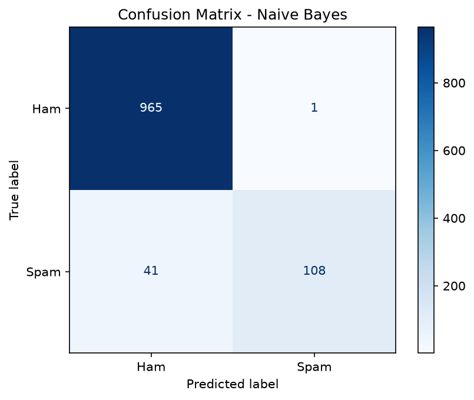

# SMS and Email Spam Detection using NLP

Mini project for TE NLP (Sem-5), Dept. of AI & Data Science Engineering.

## Problem Statement
Classify a given SMS/email text as Spam or Ham (not spam).

## Dataset
SMS Spam Collection Dataset (5,572 messages) - Kaggle / UCI.

## Approach
1. Text cleaning (lowercase, remove punctuation/numbers)
2. TF-IDF feature extraction
3. Models compared: Naive Bayes, Logistic Regression, Linear SVM
4. Streamlit web app for prediction

## Results

| Model | Accuracy |
|-------|----------|
| Naive Bayes | 96.23% |
| Logistic Regression | 96.05% |
| Linear SVM | 98.48% |
Naive Bayes is used in the final app. Confusion matrix:

## How to Run
pip install -r requirements.txt
python train.py
streamlit run app.py

## Screenshots
